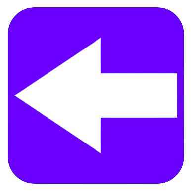

<p align="center" >
    
</p>

# Back is Basically Forth
# Overview
Back is a stack based, single pass programming language. It's a little toy language I made to experiment with interpreters. It's not intended to be a "real" language.

```
: recursive 
    ** [ 1 ] = ?
        [ done! ] ->>
    ;
    ** [ 1 ] != ?
        [ still~going... ] ->>
        [ 1 ] -
        recursive
    ;
;
    
[ 5 ] recursive
```

See the examples folder for a guide on syntax.

## Installing back
On MacOS/Linux:
```shell
curl --proto '=https' --tlsv1.2 -LsSf https://github.com/Q4REAL/back/releases/download/v0.3.1/back-installer.sh | sh
```
Powershell (Windows):
```powershell
powershell -ExecutionPolicy Bypass -c "irm https://github.com/Q4REAL/back/releases/download/v0.3.1/back-installer.ps1 | iex"
```
## Usage
to start, create a .back file (or download one from the examples directory). Run it with
```
back run -f /path/to/file.back
```

You can add dependencies to be used in other back projects like so:
```
back add -p /foo/bar/biz/
```
This will scrape this folder or file for back words and add them to ./backdeps/ You can call into your local backdeps like so, building on the last example:
```back
# follow the folder's internal dir schema #
[ biz/folder/file/word ] @

biz/folder/file/word
```
## Roadmap
This language intents to be feature complete, even if it's not really that usable.

- [x] control flow, built-in operations, stack managment
- [x] verbose mode and basic error handling
- [x] actually helpful error messages
- [x] external dependencies
- [ ] improved pattern matching
- [ ] dependency registery (backpack package managment)
- [ ] more advanced type control (like checking for numbers)
- [ ] advanced error handling
- [ ] a readable verbose mode
- [ ] FFI?